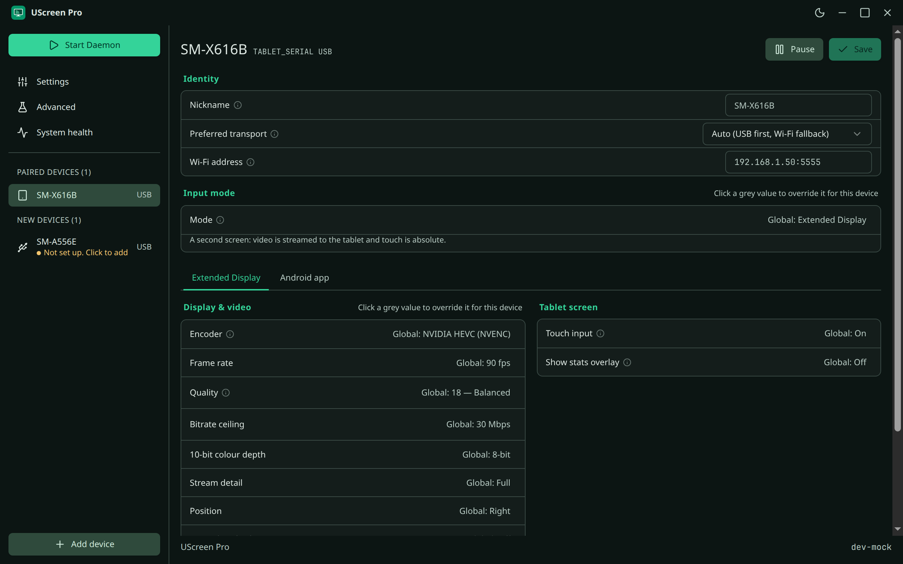
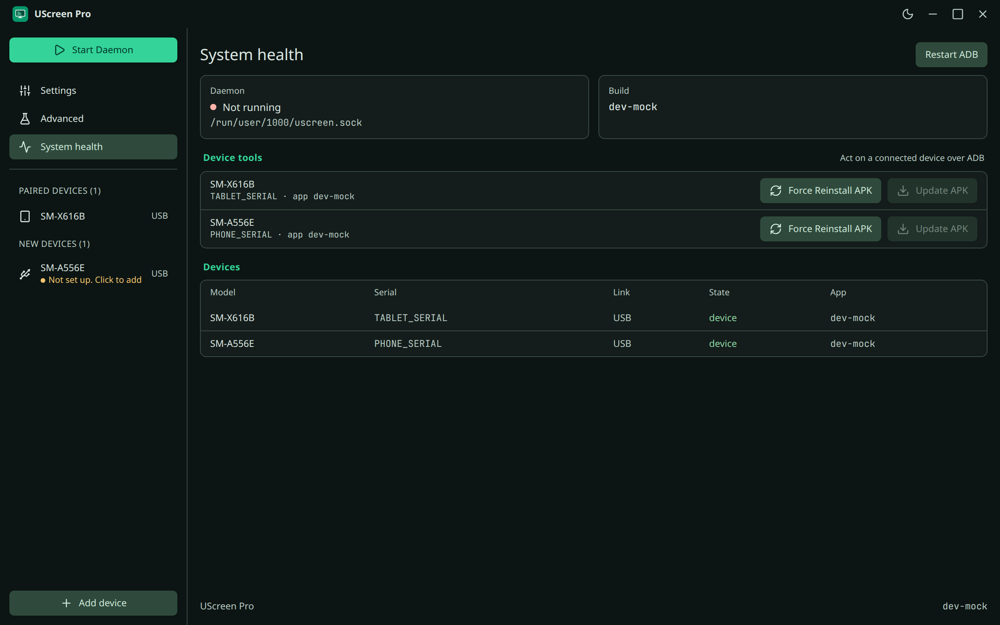
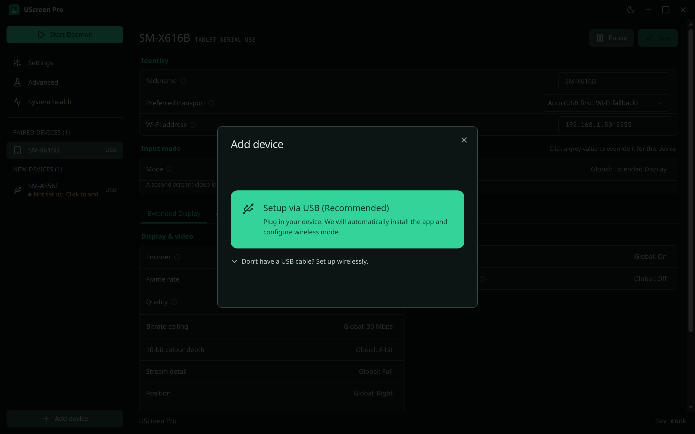
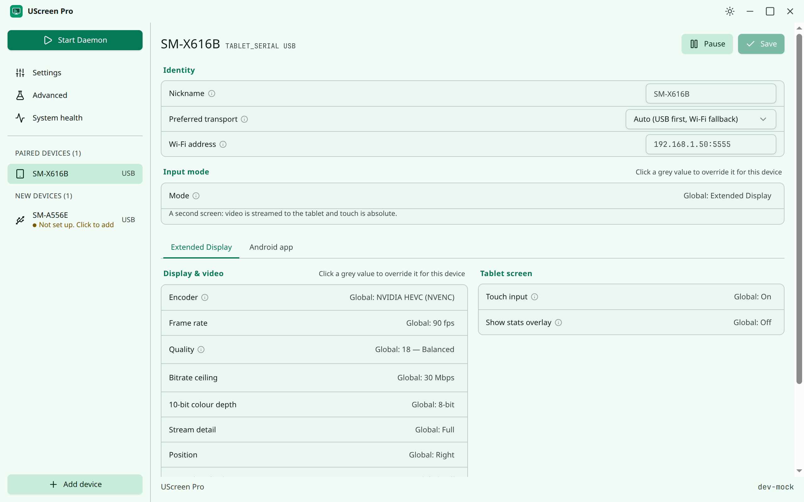

<!--
  README.md: the project's front page: what UScreen Pro is, everything it does, how to install it, and what has been run.
  Owns the overview; the complete feature table is docs/features.md, the details are on the documentation site (website/) and in docs/.
-->
<p align="center">
  
</p>

<h1 align="center">UScreen Pro</h1>

<p align="center">
  <b>Your Android tablet as a second display, a laptop touchpad and a real pen tablet, on Linux.</b><br>
  A pen that is a pressure tablet in Krita and a mouse in your browser. Copy, cut and paste from the pen.<br>
  Wired or wireless. Self-updating. Easy on the tablet's battery.
</p>

<p align="center">
  <a href="https://harshp2008.github.io/UScreen-Pro/"><b>Documentation</b></a> ·
  <a href="#install">Install</a> ·
  <a href="#everything-it-does">Features</a> ·
  <a href="docs/features.md">Full feature list</a> ·
  <a href="https://harshp2008.github.io/UScreen-Pro/experiments/">Experiments</a> ·
  <a href="CHANGELOG.md">Changelog</a>
</p>

<p align="center">
  <a href="https://github.com/harshp2008/UScreen-Pro/actions/workflows/build.yml"></a>
  <a href="https://github.com/harshp2008/UScreen-Pro/actions/workflows/installer.yml"></a>
  <a href="https://github.com/harshp2008/UScreen-Pro/actions/workflows/docs.yml"></a>
  
  
  
</p>

> **Honest status.** The one setup this project has been run on is **Ubuntu 24.04 with GNOME 46 on Wayland**, with a Samsung Galaxy Tab S9 FE.
> Other desktops, distributions and tablets are described as *not verified*, and the feature table says, row by row, what was run and what was only built.

## Why UScreen Pro

UScreen Pro continues [UScreen by majmichu1](https://github.com/majmichu1/UScreen), the open-source way to turn an Android tablet into a real second monitor on Linux.
The original gave Linux a display. **UScreen Pro makes it something you can live with every day**: a pen that behaves, a tablet that does not drain, a connection that sets itself up and
heals itself, and errors that tell you what to do.

- ✏️ **A pen that works on Ubuntu.** Real pressure, tilt and eraser. One pen that is a **graphics tablet in drawing apps and a mouse everywhere else**, switched per app. Or pick Mouse or Graphics tablet yourself.
- 📋 **Copy, cut and paste from the pen.** Hold the pen still and a small menu opens right there, only where it makes sense.
- 🖱️ **A laptop touchpad in your lap.** Native swipes and pinches, palm rejection, a right-click zone, adjustable sensitivity and shape.
- ⚡ **Fast and smooth.** Tuned low-latency HEVC, steady frame pacing, no ghost cursor, no lag crossing from one screen to the other, hardware encoding on Intel, AMD and NVIDIA.
- 🔋 **Kind to the tablet's battery.** Dim when idle with curves you can edit, battery saver when the computer is gone, optional lock, wake on touch.
- 📶 **Wired or wireless, set up for you.** A guided wizard for USB, Wi-Fi (QR or pairing code), and Tailscale (experimental).
- 🔄 **It keeps itself in step.** The tablet app is updated automatically when it no longer matches the computer, one tablet at a time.
- 🛟 **Errors you can act on.** "Host offline", "Debugging disabled", "Blocked by your router": each says what is wrong and offers the button that fixes it. `uscreen doctor` checks the rest.
- 🧰 **A new desktop app.** Device wizard, per-device overrides, system health, light and dark themes.

## See it

<p align="center">
  
</p>

<table>
  <tr>
    <td></td>
    <td></td>
  </tr>
  <tr>
    <td></td>
    <td></td>
  </tr>
</table>

The screenshots are of the desktop app with the sample data of its development mode, not a connected tablet. Photos and a recording of a real tablet are not in the repository yet;
[`docs/assets/README.md`](docs/assets/README.md) says where to add them.

## Everything it does

The short version, grouped by what you do. The complete table, with where each feature lives in the code and **whether it was run, only built, or inherited**, is
[`docs/features.md`](docs/features.md).

### Three modes, per tablet

| | Mode | What you get |
|---|---|---|
| 🖥️ | **Extended Display** | A real second monitor: a virtual display is created, encoded and streamed to the tablet; touch and pen come back. |
| 🖱️ | **Touchpad** | The tablet is a laptop touchpad. Nothing is streamed. |
| ✏️ | **Stylus** | A pen tablet for the screen you are already looking at: pressure, tilt, eraser and side buttons with no display latency. Nothing is streamed. |

Every tablet has its own mode. Change the default once and every tablet that has no override follows.

### The pen

- **Three styles.** *Mouse* (a pointer that clicks and drag-selects, with two side buttons you can map to right click, middle click or nothing), *Graphics tablet* (pressure, tilt and eraser as a real tablet device that Krita, GIMP and Blender see), and *Dynamic* (**experimental, GNOME only**): the tablet in drawing apps and the mouse everywhere else, chosen from the focused window.
- **Always a visible cursor** under the pen, even on Wayland, where tablet events normally hide it. Optionally hide it after the pen has been away.
- **The pen menu.** Hold the pen still: **cut, copy, paste, select all, undo** appear at the pen, only over an app window, only when there is a selection or something to paste. Text or icon buttons, adjustable hold time. On GNOME it is drawn inside the Shell, so it is not a window and does not steal focus.
- **Stroke handling that feels right.** A *click slop* zone keeps a tap a tap, a *hover park* filter stops a resting pen from taking the cursor from the mouse, light taps are not dropped, the pointer snaps to whole pixels, and a lifted pen sends its last position.
- **Route hotkey.** `Ctrl+Alt+P` or `uscreen toggle-tablet` flips the focused app between tablet and mouse.
- **Real drawing tablets too.** A plugged-in XP-Pen, Wacom or Huion goes through the same pen path.
- **Palm rejection and a touch switch** for drawing with a resting hand, and a **flight recorder** (`uscreen debug-dump`) for bugs that cannot be reproduced on demand.

### The touchpad

Move, tap to click, tap-and-drag, two-finger scroll, pinch, three- and four-finger swipes. On GNOME and KDE the tablet's fingers are replayed on a **virtual multi-touch touchpad**, so the desktop handles the gestures itself. Choose the **right-click method** (bottom-right zone or two-finger tap), the **shape** (full screen or a rectangle), the **sensitivity** (50 to 200 percent), and light **haptic clicks**.

### Display and speed

- A real EVDI monitor whose EDID carries the tablet's true size, placed right, left, above or below your screens.
- **Hardware encoding** on NVENC and VAAPI (Intel and AMD, including HEVC), with `libx264` as the fallback. The daemon **tests that an encoder can actually encode a frame** and falls back by itself.
- **H.264, HEVC and 10-bit.** With the decoder's low-latency hints and a tuned pipeline, HEVC reached a **24.5 ms median encode-to-display time** at 60 fps and 2560x1600 on the reference tablet, level with H.264 ([experiment 18](https://harshp2008.github.io/UScreen-Pro/experiments/)).
- **Steady frame pacing** with high-resolution timers instead of bursts and stalls, and a **Max performance mode** that keeps 60 fps when the computer is in its performance profile.
- **No ghost cursor, no boundary lag.** Moving the mouse from the laptop to the tablet and back is smooth.
- **Per-device overrides** for encoder, codec, frame rate, bitrate, quality, scale and position; **several tablets** at once, each isolated from the others.
- `uscreen doctor --latency` measures it on your own machine, stage by stage.

### Connection: wired, wireless, Tailscale

- **USB** through adb: plug in, and the daemon forwards the ports, launches the app and builds the display.
- **Wireless in one click** from the wizard, or by **QR code or pairing code** on Android 11 and newer (the one-click path was run; the QR path could not be confirmed end to end on the test network). Wi-Fi is prepared when you first plug in, so unplugging just keeps going.
- **Tailscale** for when the LAN will not do (**experimental**).
- **Transport per device**: USB, Auto (cable first, Wi-Fi as the fallback) or Wi-Fi.
- If the router blocks the tablet, the wizard **says so and tells you how to fix it** (MAC randomization, client isolation) instead of spinning for a minute and a half.
- Both ports are loopback-only and need a per-run session token.

### Battery and power

- **Idle dimming**: the tablet dims while your pointer is elsewhere and wakes on any touch or pen input. You choose the **fade curve** from presets or draw a custom one in a live **curve editor**, and save it.
- **Battery saver**: two minutes after the computer disappears, the tablet stops retrying and dims to 10 percent. It can also lock the tablet if you allow Device Admin.
- A black screen in Stylus mode so an OLED panel is not left lit, wake on touch, and lock-screen options.

### The tablet app

A redesigned Material 3 app, light or dark or follow the system, with settings in four cards (Display and input, Connection, Power and battery, Advanced). Immersive mode, safe-area handling for cutouts, automatic or fixed orientation, a stats overlay, a pairing guide, and a decoder that recovers by itself instead of freezing.

### Errors that help

| You see | It means | The button |
|---|---|---|
| **Host Offline** | The daemon stopped or the connection dropped | Retry Connection |
| **Debugging Disabled** | USB debugging is off | Open Developer Options |
| **Connection Blocked by Router** | The router isolates clients | How to fix MAC randomization, Retry Setup |
| **Connection Paused by Host** | You paused this tablet | (resumes when you do) |
| **Updating** | The app is being replaced to match the computer | (nothing; it comes back) |
| **Version mismatch** | App and computer builds differ | Force Reinstall APK |

The **compositor safety guard** keeps the virtual monitor from ever stalling your desktop: it waits for the compositor to be up and idle, limits hotplugs, detects a stall, and refuses to start after an unclean end (`uscreen reset-guard` clears it).

### Updates

When a tablet connects, the daemon compares the app on it with its own version and installs the matching APK itself, through a queue so several tablets do not saturate USB. Updating one tablet leaves the others streaming. Every build carries its git commit and a *dirty* flag. A daily check (switchable) tells you in the tray and in `uscreen doctor` when a new release exists; nothing installs itself behind your back.

### The desktop app

A new Tauri app: **device wizard** (Prepare Device, Connect USB, Install, Wireless, Finish), **device pages** with an override switch per row, **global settings**, **system health** (daemon, build, device tools, Restart ADB, Force Reinstall APK), real Pause, Forget device, Start with desktop, and light and dark themes. Settings **follow you**: the tablet app and the desktop app edit the same file, a global change clears the per-device override, a device change applies to that device, and the newest change wins.

### Built to be extended and checked

A **tested installer** with a plan mode and a dry run (60 tests), one file per distribution family, one directory per desktop, one row per GNOME Shell version ([Adding support](docs/adding-support.md)). Every function has a doc comment. The **62 experiment records** of what was tried and found are published. The **documentation site** is built and link-checked in CI.

## Install

1. **Linux side.** From a checkout or an unpacked release:

   ```bash
   ./scripts/install.sh            # asks what to install; add --dry-run to see every command first
   ```

   It detects your distribution family, installs `ffmpeg`, `adb` and the EVDI virtual-display module with the right package manager, and puts everything else in your home directory.
   It tells you at the end whether you need to log out or reboot (`UScreen-INSTALL-RESULT: relogin=… reboot=…`). Options: [`docs/installer.md`](docs/installer.md).
2. **Tablet.** Install `uscreen.apk` and turn on USB debugging, or let the wizard do both.
3. **Plug in** and start the daemon (`uscreen start`, or the Start button in the desktop app). If something is off, run `uscreen doctor`.

Update both halves together: they share a session token (and the daemon will update the tablet app for you). What the installer changes on your system: [Install](https://harshp2008.github.io/UScreen-Pro/install/) and [`SECURITY.md`](SECURITY.md).

## UScreen and UScreen Pro

| | [UScreen](https://github.com/majmichu1/UScreen) | UScreen Pro |
|---|---|---|
| Extended display over USB, EVDI capture, adb transport | ✅ | ✅ (inherited, re-tuned) |
| Pen with pressure, tilt, eraser, buttons | ✅ | ✅ |
| Pen styles: Mouse, Graphics tablet, **Dynamic per app** | | ✅ |
| **Pen menu** (cut, copy, paste, select all, undo) | | ✅ |
| Pen cursor handling: ghost tracking, hover park, click slop | | ✅ |
| Touchpad | ✅ basic | ✅ **native gestures**, shapes, sensitivity, haptics |
| **Idle dimming, fade curves, battery saver** | | ✅ |
| **Wizard** with QR / code pairing, one-click wireless, Tailscale (experimental) | `uscreen wifi` | ✅ |
| **Automatic app update** per device | not documented | ✅ |
| **Compositor safety guard**, Intel freeze fixes | | ✅ |
| Desktop app | settings window (`uscreen-gui`) | **new Tauri app**, device pages, overrides, health |
| Tablet app | original | **redesigned**, settings cards, pairing guide, error screens |
| Physical drawing tablets (XP-Pen, Wacom) | | ✅ |
| Distribution packages (`.deb`, `.rpm`, PKGBUILD) | ✅ | recipes kept, **not re-run** |
| Verified setups | Bazzite KDE, Arch KDE, Fedora KDE, Ubuntu GNOME | **Ubuntu 24.04 GNOME 46 only** |

UScreen Pro ports the backend fixes of upstream's 1.2.14. It is **not** a drop-in replacement for upstream's packages, and it has not been run on the setups upstream has.

## How it works

```text
 Computer                                                         Tablet
 ┌──────────────┐   frames   ┌───────────┐  H.264 / HEVC   ┌─────────────────────────┐
 │ EVDI virtual │ ─────────▶ │ ffmpeg    │ ───── USB ────▶ │ Android app: decodes    │
 │ display (C   │   NV12     │ encoder   │   (adb reverse) │ and shows the picture   │
 │ helper)      │            └───────────┘                 │                         │
 └──────────────┘            ┌───────────┐  touch, pen     │ sends touch, pen and    │
   Daemon (Rust) ◀────────── │ uinput    │ ◀──── JSON ──── │ touchpad events         │
   + GNOME extension         │ devices   │   (WebSocket)   └─────────────────────────┘
                             └───────────┘
```

Both connections are on loopback and need a per-run session token. The details are in [Behaviour notes](https://harshp2008.github.io/UScreen-Pro/project/behavior-notes/).

## Repository map

| Path | What is in it |
|---|---|
| `host/` | the daemon (`uscreen`, Rust); `host/evdi/` the C helper; `host/src/desktop/<name>/` one directory per desktop |
| `uscreen-pro-gui/` | the desktop app (Tauri + React) |
| `android/` | the tablet app (Kotlin, Jetpack Compose) |
| `menu/` | the GTK 4 fallback pen menu |
| `extensions/uscreen-app-lock/` | the GNOME Shell extension (app lock, pen routing, context probe, pen menu), with a `compat/` layer for Shell versions |
| `scripts/` | the installer (`install.sh`, `lib/distros/<family>.sh`) and its tests |
| `website/` | the documentation site ([Starlight](https://starlight.astro.build/)) |
| `docs/`, `experiments_and_findings/` | the project documents and the original write-ups |

## Contributing

Build and test commands are on [Testing](https://harshp2008.github.io/UScreen-Pro/testing/), the comment rules in [`docs/comment-style.md`](docs/comment-style.md), and the contribution
workflow in [`CONTRIBUTING.md`](CONTRIBUTING.md). Security issues: [`SECURITY.md`](SECURITY.md). Reports of what works on **other desktops, distributions and tablets** are the most useful thing right now.

## Credits

UScreen Pro is a continuation of **[UScreen](https://github.com/majmichu1/UScreen) by [majmichu1](https://github.com/majmichu1)**, which provided the original design, the
EVDI capture pipeline and the first Android app. This repository keeps its history and its MIT licence. Third-party libraries are listed in
[`THIRD_PARTY_LICENSES.md`](THIRD_PARTY_LICENSES.md); the window-placement tool [spawn-at](https://github.com/harshp2008/spawn-at) is a companion project.

## License

MIT. See [`LICENSE`](LICENSE).
