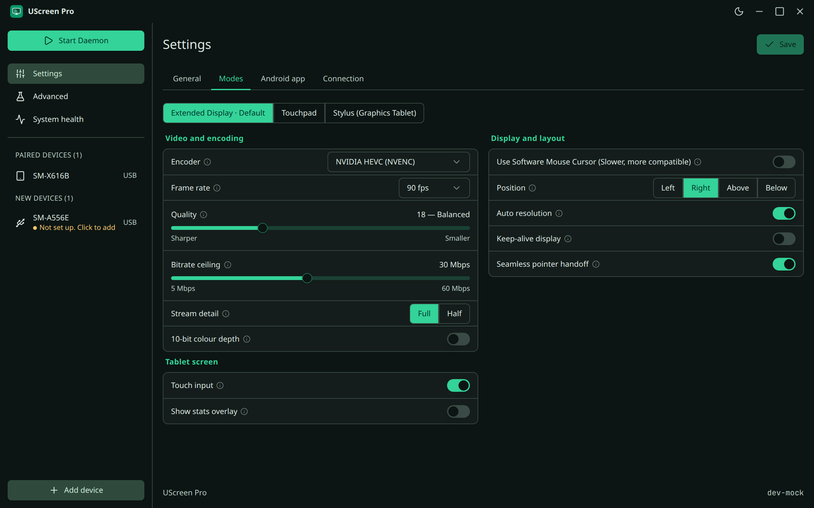

<!--
  README.md: the project's front page: what UScreen Pro is, how to install it, and what has been run.
  Owns the short overview; the complete feature table is docs/features.md, the details are on the documentation site (website/).
-->

  

<h1 align="center">UScreen Pro</h1>

  Your Android tablet as a <b>second display</b>, a <b>laptop touchpad</b> and a <b>real pen tablet</b>, on Linux.

  <a href="https://harshp2008.github.io/UScreen-Pro/"><b>Docs</b></a> ·
  <a href="#install">Install</a> ·
  <a href="docs/features.md">All features</a> ·
  <a href="CHANGELOG.md">Changelog</a>

  
  
  

## Set up in three steps

1. **Run the installer.** `./scripts/install.sh` detects your distribution, shows what it will install, asks before it does, and tells you if you need to log out. (`--dry-run` shows every command first.)
2. **Add your tablet.** Open UScreen Pro, press **Add device** and plug the tablet in. The app is installed on it and wireless is set up for you. You turn on USB debugging once; the wizard shows how.
3. **Use it.** Plug in whenever you like. If something looks off, run `uscreen doctor`.

Details: [Install](https://harshp2008.github.io/UScreen-Pro/install/).

## What Pro adds

- ✏️ **A pen that works.** A pressure tablet in drawing apps and a normal mouse everywhere else, switched per app (Dynamic: GNOME, experimental) or set by hand.
- 📋 **Cut, copy and paste from the pen.** Hold it still and a small menu opens at the tip.
- 🖱️ **A real touchpad.** Native swipes and pinch, palm rejection, right-click zone.
- ⚡ **Fast and smooth.** Tuned HEVC, steady frames, no ghost cursor.
- 🔋 **Battery care.** Dim when idle, battery saver when the computer is gone.
- 📶 **Wired or wireless.** USB and Wi-Fi, with a setup wizard. Tailscale is experimental.
- 🔄 **Self-updating.** The tablet app is reinstalled when it stops matching the computer.
- 🛟 **Helpful errors.** Each failure says what to do and has a button for it.
- 🧰 **New apps.** A desktop app with a device wizard and per-device settings, and a redesigned tablet app.

Every feature, with where it lives and whether it was run, is in [`docs/features.md`](docs/features.md).

  

## Status

Run on **Ubuntu 24.04, GNOME 46, Wayland** with a Galaxy Tab S9 FE+ and its S Pen, including pen pressure in Krita. **Not verified:** Tailscale and QR pairing. The screenshots are the app's sample data, not a connected tablet.

## Credits

UScreen Pro started from **[UScreen](https://github.com/majmichu1/UScreen)** by majmichu1 and keeps its idea, its virtual-display capture and its adb link. The desktop app, the tablet app, the input engine and the installer are new, and most of the rest has been reworked. MIT licence, see [`LICENSE`](LICENSE) and [`THIRD_PARTY_LICENSES.md`](THIRD_PARTY_LICENSES.md). Contributing: [`CONTRIBUTING.md`](CONTRIBUTING.md).
